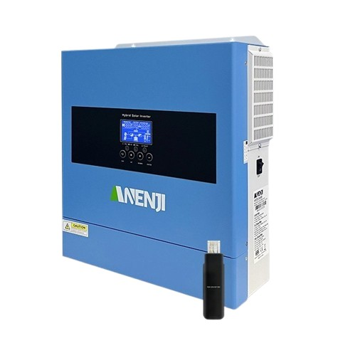
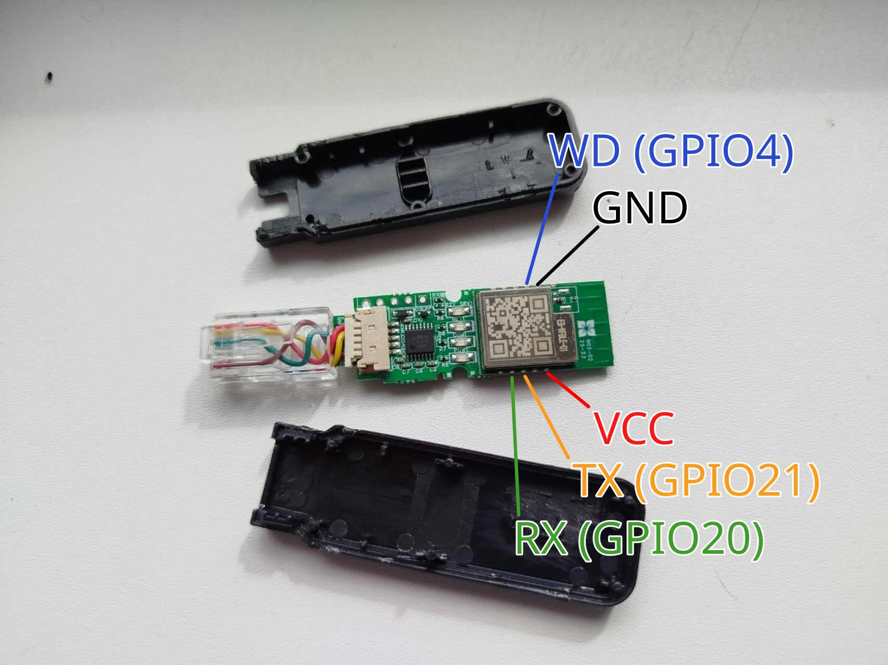

# ESPHome configuration for Anenji 4.2kW 24V

Based on https://github.com/psalkiewicz/esphome-2026-anenji4200

Renamed option names to match documentation that comes with the Anenji 4.2 kW 24V inverter. Missing options added too.

Original WiFi adapter is modified to use ESP32C3. WiFi module is removed and replaced with ESP32C3 module.

Connections (remove exiting WiFi module first):

